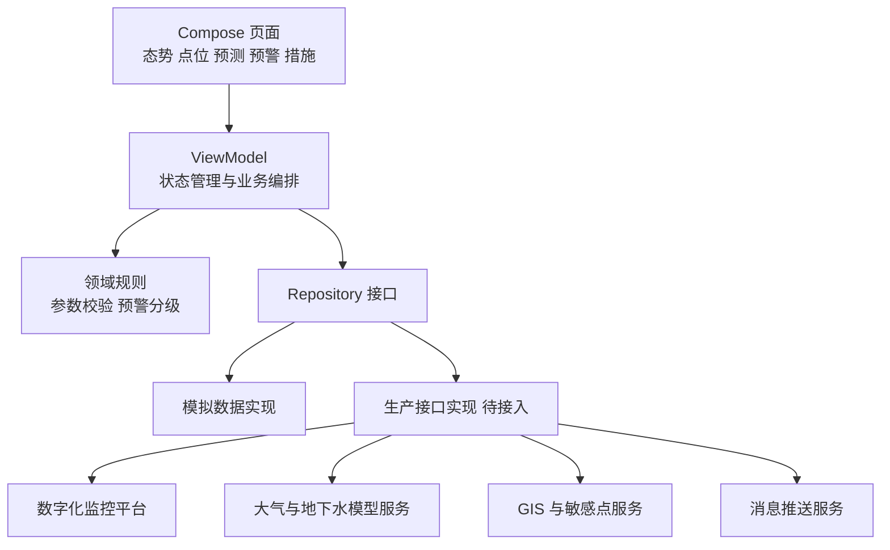

# 架构说明

## 设计原则

项目首期采用单 Android 模块、按业务能力分包的结构。真实数据协议和模型部署方式确认前，不提前拆分远程模块；接口稳定后可将数据接入、模型适配和地图能力独立为 Library 模块。

## 包结构

- `data/model`：跨页面统一数据对象和枚举。
- `data/repository`：数据访问接口与模拟实现。
- `domain`：不依赖 Android 的参数校验和预警规则。
- `ui/screens`：五个核心业务页面。
- `ui/components`：跨页面复用的紧凑型监控组件。
- `notifications`：系统通知渠道、消息内容和跳转入口。

## 后续拆分条件

满足以下任一条件时再拆分 Gradle 模块：模型代码需要独立发布；地图供应商 SDK 引入较重依赖；生产接口由不同团队独立维护；或单模块构建时间显著影响开发效率。

